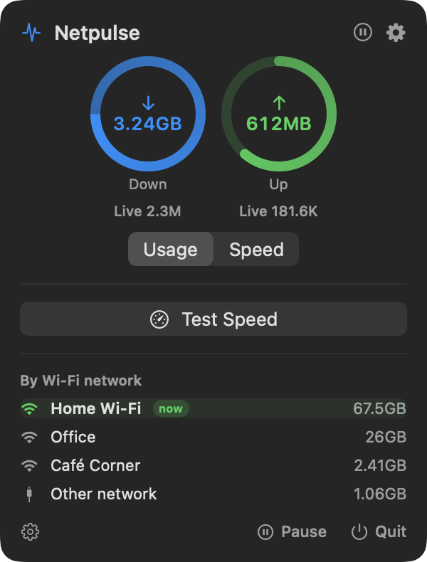
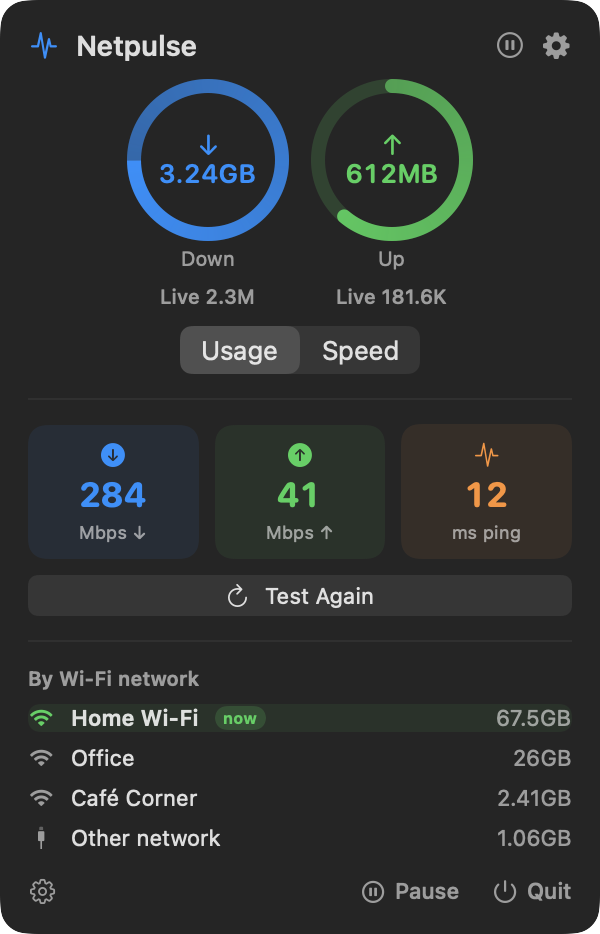

<p align="center">
  
</p>

<h1 align="center">Netpulse</h1>

<p align="center">
  <strong>How much data you've used today, how fast your connection really is - right in the macOS menu bar.</strong>
</p>

<p align="center">
  <a href="https://github.com/pratik-adh/netpulse/actions/workflows/build.yml"></a>
  <a href="https://github.com/pratik-adh/netpulse/releases/latest"></a>
  
  <a href="LICENSE"></a>
</p>

Netpulse is a small, native menu bar app that keeps a running total of your
network usage - today, this week, this month - and, one click away, shows live
upload/download speed, a per-Wi-Fi breakdown, and a real speed test.

```
menu bar:    ↓ 3.24GB ↑ 612MB     ← today's usage (or this week's / month's)
click:       live speed rings, Test Speed, usage by Wi-Fi network
right-click: today's totals · pause · settings · quit
```

**No Dock icon. No account. No analytics or telemetry - usage is read locally
and never leaves your Mac.** The only network request it ever makes is the
speed test, and only when you tap the button.

<p align="center">
  
  &nbsp;&nbsp;
  
</p>

> Netpulse started life as the network tab inside
> [Downtime](https://github.com/pratik-adh/downtime), a break-reminder app. It's
> now its own app, so you can run either one without the other.

---

## Why

You're tethered to your phone's hotspot, on a capped plan, or just curious
where the gigabytes go. Activity Monitor has the numbers, but only while it's
open, only since boot, and with no idea what "today" means. Speed test
websites tell you what your line can do, but not what you've actually used.

Netpulse keeps both in the menu bar:

- **A total you can read at a glance.** The menu bar shows usage, not a rate -
  a number that ticks every second is hard to read and stops meaning anything
  the moment you look away. Pick today, this week, or this month.
- **Live speed one click away.** Two rings in the popover show live ↓/↑, or
  today's usage - your choice.
- **A real speed test, on demand.** Latency, download and upload, with the
  rings turning into a live gauge while it runs.
- **Usage by Wi-Fi network.** Opt-in: see how much went over home Wi-Fi, the
  office network, or that café.
- **A daily data budget.** Pick a threshold and get one nudge notification the
  day you cross it.

---

## Features

**Menu bar readout** - `↓ 1.2GB ↑ 340MB`, or one combined `↓↑ 1.5GB`, for
today, this week, or this month. It's set in a fully monospaced font so the
item doesn't jitter or shove its neighbours sideways as the numbers change,
and it only redraws when the visible text actually changes. Prefer a bare
icon? Turn the readout off.

**The popover** (left-click) - two rings for download and upload. By default
the big number is today's usage, with live speed underneath; a **Usage /
Speed** switch swaps them. In Usage mode the ring fills toward your daily data
budget (or 1 GB if you haven't set one); in Speed mode, toward 5 MB/s.

**Speed test** - tap **Test Speed** for latency, then a ~25 MB download and a
~10 MB upload against Cloudflare's public speed-test endpoints
(`speed.cloudflare.com`). While it runs, the rings become a live 0-100 Mbps
gauge of the transfer in progress; it finishes with three result chips
(↓ Mbps, ↑ Mbps, ping). **Cancel** any time. Closing the popover clears the
result, so it never shows a stale number. With no network path at all, you
get a plain "No network connection available" notice instead of a test that's
bound to fail.

**By Wi-Fi network** - off by default. Labels usage by the Wi-Fi network you
were on at the time, largest first, with a green **now** badge on the current
one. Wired and unreadable connections are grouped as "Other network." Click a
row to open macOS's own Wi-Fi settings.

**Daily data budget** - off by default. Pick 500 MB to 20 GB; crossing it
sends one notification for the day. It's a nudge, not a block - actually
throttling traffic needs a Network Extension and a signing setup this app
deliberately doesn't have.

**History** - today, this week, this month, and an all-time total (up to 120
days), each as separate ↓/↑ figures or one combined total. **Reset usage
history…** clears it, with a confirmation.

**Pause** - right-click → **Pause tracking**, or the popover's Pause button.
The icon turns into a pause glyph (it never disappears - it's the app's only
way in), and the popover collapses to a single **Resume tracking** button.
Nothing that moves while paused gets counted.

**Open at login**, and a **Restore all defaults** button that leaves your
history alone.

📖 **[Full feature reference → FEATURES.md](FEATURES.md)**

---

## Install

**Download:** grab `Netpulse-<version>-macOS.zip` from the
[latest release](https://github.com/pratik-adh/netpulse/releases/latest), unzip
it, and drag **Netpulse.app** into `/Applications`. It's a universal binary
(Apple silicon and Intel), macOS 13 (Ventura) or later.

**Build from source:** you need the Xcode Command Line Tools - **not** full Xcode.

```sh
xcode-select --install     # once, if `swift` isn't on your PATH

git clone https://github.com/pratik-adh/netpulse.git
cd netpulse
./build.sh --install       # compile, bundle, move to /Applications, launch
```

Or build without installing:

```sh
./build.sh
open "dist/Netpulse.app"
```

The first launch puts the usage readout in your menu bar and nothing in the
Dock - that's deliberate (`LSUIElement`). Quit from the right-click menu or the
popover's footer.

> **Unsigned build note:** this is ad-hoc signed, not notarized. macOS may warn
> on first launch - right-click the app → Open, or allow it in
> System Settings → Privacy & Security.

---

## Privacy

- **Usage is read locally.** Once a second, Netpulse reads the same cumulative
  interface byte counters Activity Monitor's Network tab and `netstat -ib` use
  (`sysctl(NET_RT_IFLIST2)`), across every interface except loopback. No
  permission prompt, no packet capture, no per-app snooping.
- **One network request, on demand.** The speed test is the only thing that
  ever talks to the internet, and only when you tap **Test Speed**. Nothing
  personal is attached beyond what any HTTPS request carries.
- **Wi-Fi names need Location Services** - a macOS rule since Catalina,
  because a network name can reveal where you are. Netpulse only asks when you
  turn on **By Wi-Fi network**, and the name only labels your own local
  history.
- Settings live in your user defaults under `com.netpulse.mac`; history lives
  in `~/Library/Application Support/Netpulse/stats.json`.
- No analytics, no accounts, no update checks.

---

## Source layout

```
Package.swift
build.sh                          compile → "Netpulse.app" (icon, ad-hoc signature)
Resources/
  Info.plist                      LSUIElement, bundle id com.netpulse.mac
  icon_1024.png                   source art; build.sh turns it into AppIcon.icns
  MakeIcon.swift                  redraws icon_1024.png from code (CoreGraphics)
Sources/Netpulse/
  main.swift                      NSApplication bootstrap, accessory policy
  AppDelegate.swift               wires the model to the two controllers
  Models/
    Settings.swift                preferences, forgiving decode
    Stats.swift                   daily usage history, per-network totals, JSON store
  Core/
    AppModel.swift                the engine: 1-second tick, usage, budget, speed test
    NetworkMonitor.swift          sysctl interface byte counters (up/down)
    WiFiMonitor.swift             CoreWLAN + CoreLocation: current Wi-Fi name
    NetworkReachability.swift     NWPathMonitor: is there a network path at all?
    SpeedTestService.swift        the one place this app makes a network request
    NotificationManager.swift     the daily data budget nudge
    DesignTokens.swift            appearance-aware colour tokens
    Format.swift                  bytes and speeds
    LaunchAtLogin.swift           SMAppService + LaunchAgent fallback
  UI/
    NetworkStatusItemController.swift  the menu bar item, its popover and menu
    SettingsWindowController.swift
    Views/
      NetworkPopoverView.swift    rings, speed test, Wi-Fi list
      SettingsView.swift          Usage, General, Support
      Components.swift            the progress ring
```

**No third-party dependencies** - everything is built on system frameworks
(Network, CoreWLAN, CoreLocation, UserNotifications, ServiceManagement) and the
same BSD interface counters `nettop` reads.

---

## Troubleshooting

**The numbers don't match my carrier's.** Netpulse counts every byte through
every interface on this Mac (Wi-Fi, Ethernet, VPN tunnels - a VPN can make
traffic count twice, once inside the tunnel and once outside). Your carrier
counts what crossed their network, from every device on the plan.

**Wi-Fi names show as "Other network."** Location access is off or was
declined. Enable it in System Settings → Privacy & Security → Location
Services, then toggle **By Wi-Fi network** off and on again.

**No budget notification.** Check System Settings → Notifications → Netpulse.
Notifications need the bundled, signed app (`build.sh` does both); running the
raw binary won't work.

**"Open at login" won't stick.** Ad-hoc-signed builds are sometimes refused by
`SMAppService`; a LaunchAgent fallback covers it, and the toggle reports what
actually happened.

---

## Contributing

Issues and pull requests are welcome. The codebase is deliberately small and
dependency-free - please keep it that way.

Every push and pull request builds on macOS via GitHub Actions
(`.github/workflows/build.yml`). Pushing a `vX.Y.Z` tag triggers
`.github/workflows/release.yml`, which builds the universal binary, zips it,
and publishes a GitHub release.

---

## License

MIT - see [LICENSE](LICENSE).
